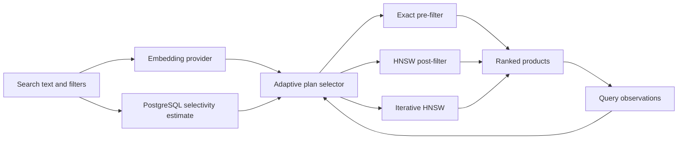

# SAHVS

SAHVS is a selectivity-aware adaptive query planner for product searches that combine semantic similarity with relational filters. PostgreSQL stores both the product metadata and 384-dimensional embeddings. The application measures previous executions and chooses among three physical search strategies for each request.

This repository is the implementation for a DBMS research project. It separates the database problem from the interface: the central contribution is the plan-selection policy, not natural-language parsing or a chatbot.

## How the database is used

Every product is a normal PostgreSQL row with columns for category, brand, price, rating, stock status, and a pgvector embedding. B-tree indexes support metadata predicates and an HNSW index supports approximate vector retrieval.

The API converts the search text to an embedding, asks PostgreSQL to estimate how many rows satisfy the filters, and builds a feature vector containing selectivity, table size, predicate count, requested `k`, and candidate budget. The adaptive planner then selects one of these plans:

| Plan | Database execution | Best fit |
| --- | --- | --- |
| `exact_prefilter` | Apply metadata predicates, calculate exact cosine distance, then sort | Very selective filters |
| `ann_postfilter` | Retrieve a bounded HNSW candidate set, then apply metadata predicates | Broad filters |
| `ann_iterative` | Put predicates inside an iterative HNSW scan | Moderately selective filters |

If an approximate plan returns fewer rows than PostgreSQL estimates are available, the online endpoint runs the exact plan as a recall guard. The benchmark bypasses this fallback so each raw strategy can be evaluated fairly.



## Run with Docker

Docker Desktop is the only host requirement.

```bash
docker compose up --build -d
docker compose exec api python scripts/seed.py --count 50000 --replace
```

Open [http://localhost:8000](http://localhost:8000). API documentation is available at [http://localhost:8000/docs](http://localhost:8000/docs).

The seed command creates a deterministic synthetic catalog. Re-running it with the same seed produces the same products and embeddings.

## Deploy on Vercel

Vercel can run the FastAPI application, but it cannot run the PostgreSQL container from
`compose.yaml`. Connect the project to a hosted PostgreSQL provider with pgvector support
(for example, Neon or Supabase), then add its pooled connection string as `DATABASE_URL` in
the Vercel project settings for Production and Preview.

Initialize and seed that hosted database once from a trusted machine:

```bash
psql "$DATABASE_URL" -f db/init.sql
DATABASE_URL="$DATABASE_URL" python scripts/seed.py --count 50000 --replace
```

Redeploy after adding or changing the environment variable. Without `DATABASE_URL`, the
web interface still loads and the health endpoint reports a configuration error, but search
remains unavailable because all three query plans require PostgreSQL and pgvector.

## Run the experiment

After seeding the database:

```bash
docker compose exec api python scripts/benchmark.py --repetitions 5
docker compose exec api python scripts/ablation.py --repetitions 5
```

The benchmark runner executes the same workload using all three strategies. Exact pre-filtering supplies the ground-truth top-k set. The ablation runner then evaluates the full system against versions without feedback, selectivity, dynamic candidate sizing, or the recall guard. Timestamped CSV and JSON files are written to `results/` with:

- mean, median, and p95 query latency;
- recall at k against exact search;
- percentage of queries returning all requested rows;
- selectivity and estimated matching rows;
- candidate budget for each query.

Run the workload once to populate observations, then run it again to evaluate the learned planner through the search API. The raw strategy benchmark intentionally records every execution so each plan has enough training examples.

## Validated local results

The first reproducible run used PostgreSQL 17, pgvector 0.8.7, 50,000 synthetic products, hash embeddings, ten workload queries, `k = 10`, and five repetitions per condition. Recall is tie-aware because the generated catalog contains products with equal cosine distances.

| Method | Mean latency | Mean recall at 10 | Full result rate |
| --- | ---: | ---: | ---: |
| Exact pre-filter | 18.21 ms | 1.00 | 1.00 |
| ANN post-filter | 0.63 ms | 0.56 | 0.70 |
| Iterative HNSW | 0.87 ms | 0.81 | 1.00 |
| Full adaptive planner | 6.42 ms | 1.00 | 1.00 |

The adaptive planner was 2.83 times faster than exact search at the same mean recall. Removing workload feedback reduced recall to 0.81. Removing selectivity reduced recall to 0.89 and increased mean latency to 7.02 ms. The fixed-budget and no-guard variants matched the full system on this stable workload because the learned planner avoided incomplete plans; these safeguards require a shifted or exploratory workload to measure their effect.

## Local development

PostgreSQL with pgvector must be running separately for API or integration tests.

```bash
python3 -m venv .venv
source .venv/bin/activate
pip install -e '.[dev]'
pytest -q
ruff check .
uvicorn app.main:app --reload
```

Copy `.env.example` to `.env` to change the database URL or planner settings.

## Embedding options

The default `hash` provider requires no model download and makes demos deterministic. It uses feature hashing plus a small product-domain synonym map. This provider is suitable for software tests, but it must not be presented as a learned semantic model in the report.

For the final experiment, install the optional ML dependencies and select MiniLM:

```bash
pip install -e '.[ml]'
export EMBEDDING_PROVIDER=sentence-transformers
export MODEL_NAME=sentence-transformers/all-MiniLM-L6-v2
python scripts/seed.py --count 50000 --replace
```

Query-time and stored embeddings must always come from the same provider and model.

## API example

```bash
curl -X POST http://localhost:8000/api/search \
  -H 'Content-Type: application/json' \
  -d '{
    "query": "lightweight modern laptop",
    "filters": {"category": "Laptops", "max_price": 70000},
    "k": 10
  }'
```

Set `strategy` to `exact_prefilter`, `ann_postfilter`, or `ann_iterative` to bypass adaptive selection. Leave it `null` to use the planner.

## Planner learning

The cold-start policy uses transparent selectivity thresholds. After every strategy has enough observations, SAHVS estimates each plan's cost from the five closest observed query contexts. The cost combines measured latency with penalties for incomplete results and benchmark-measured recall below 0.95. Ten percent of requests are exploration samples by default, preventing the planner from relying indefinitely on stale measurements.

This design supports the planned ablation study:

1. Full SAHVS with selectivity, feedback, dynamic candidate budgets, and recall guard.
2. No selectivity feature.
3. No runtime feedback, which leaves only the cold-start policy.
4. Fixed candidate budget.
5. No exact-search recall guard.

## Project layout

```text
app/
  embeddings.py     deterministic and MiniLM embedding providers
  planner.py        cold-start rules and learned cost models
  query_sql.py      parameterized SQL for all physical plans
  repository.py     PostgreSQL connection and observation logging
  main.py           FastAPI service and recall guard
  static/index.html experiment interface
db/init.sql          schema, constraints, B-tree indexes, and HNSW index
scripts/seed.py      reproducible product generator
scripts/benchmark.py baseline and recall experiment runner
scripts/ablation.py  component-removal experiment runner
tests/               unit tests for planner, SQL, models, and embeddings
```

## Current limitation

The exact, post-filter, and iterative-HNSW paths require PostgreSQL with pgvector. Unit tests can run without a live database, but latency and recall results must be produced on one fixed machine with Docker or a local PostgreSQL installation. No benchmark numbers are hard-coded into the project.
